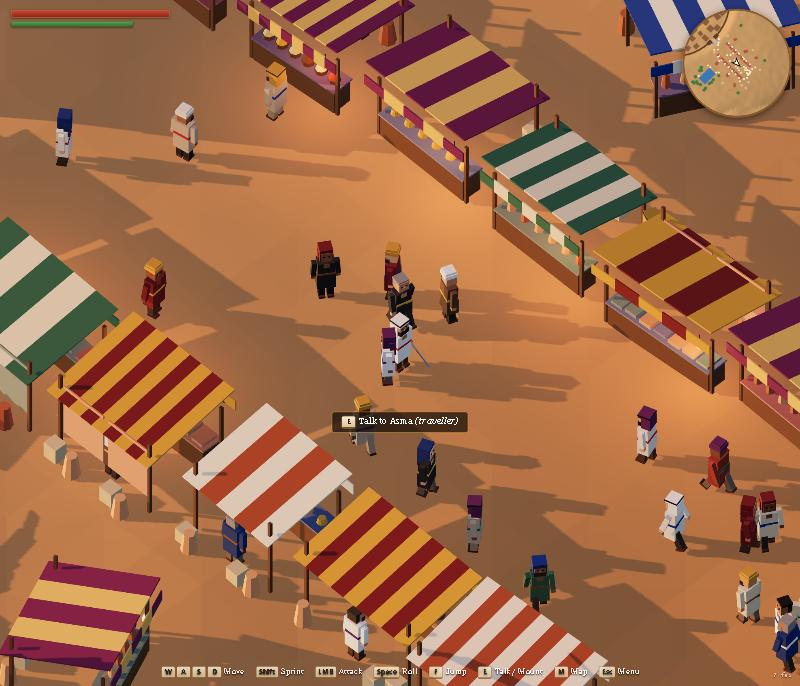
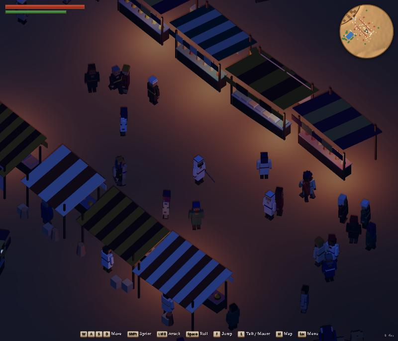
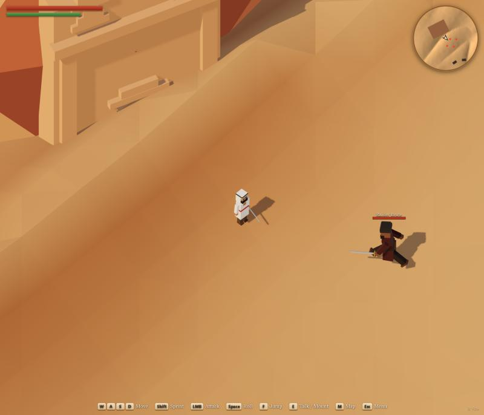
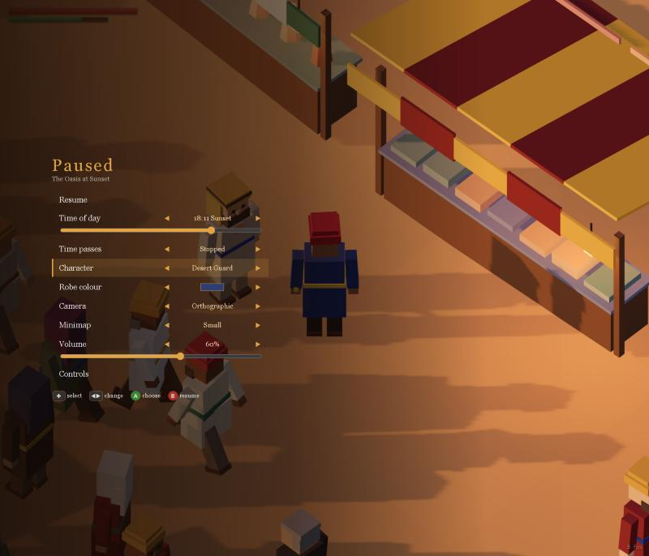

# Sands of Arabia

A small browser RPG set in a pre-Islamic Arabian oasis town at sunset. It's low-poly and voxel-like, with an orthographic, high-angle camera in the style of Shadowrun Returns.

**▶ Play: https://cnblackxp.github.io/sands-of-arabia/**

It runs in any modern desktop browser with WebGL 2, using keyboard and mouse or a gamepad.



## What's in it
- **A walled mudbrick town:** tower houses, a columned shrine, a striped market outside the gate, palms around a pool, a Bedouin camp, a Nabataean rock-cut tomb and open dune country.
- **People:** about 65 townsfolk with roles (merchants, wanderers, water carriers, sitters, gate guards, a priest), each with their own lines when you talk to them.
- **Souls-like sword combat:**
  - Stamina is spent on attacks, rolls, jumps and sprinting.
  - The dodge roll has i-frames.
  - Attacks commit you with a lunge.
  - Raider camps out in the dunes hold three enemy types: skirmisher, raider and brute. Each telegraphs its swing with a slow windup and a red flash, then leaves an opening after it.
- **Horses:** mount one, gallop across the dunes, and fight from the saddle.
- **A composite bow:** aim, watch the arc, loose, then pull your arrows back out of the sand. The quiver holds ten.
- **Beasts and new raiders:** desert hounds that circle and lunge, vultures that dive from the sky, slingers who keep their distance, and clubmen.
- **Time of day:** dawn, noon, sunset and a blue moonlit night, with a sky dome, stars and lit market lamps. Set it in the pause menu or let time pass.
- **A pause menu** where you can choose a character look, robe colour, camera mode, minimap size and volume. It works with mouse, keyboard and controller.
- **A minimap and on-screen prompts** that switch between keyboard and controller glyphs for whichever device you're using.

| Night market | Raiders at the tomb | Pause menu |
|---|---|---|
|  |  |  |

## Controls
| Action | Keyboard & mouse | Controller |
|---|---|---|
| Move | WASD | Left stick |
| Sprint (free out of combat) | Shift | Hold B (or L3) |
| Attack | Left click or J | RT |
| Block (with a shield) / aim a bow | Right mouse (hold) | LT (hold) |
| Loose an arrow (bow) | Left click | RT |
| Dodge roll | Space | Tap B |
| Jump (hold for height, double jump with the feather) | F | A |
| Drink a healing waterskin | R | X |
| Talk, trade, rest, open, travel, mount | E | Y |
| Rotate camera | Middle-mouse drag, or Z / C | Right stick |
| Look (third-person test camera, Debug tab) | Mouse (click to capture) | Right stick; D-pad up/down zooms |
| Zoom | Mouse wheel | Right stick / D-pad |
| Map | M | View |
| Menu (inventory, quests, travel, settings) | Tab or Esc | Start |

## Running locally
You need Node 20.19+ or 22.12+.

```bash
npm install
npm run dev        # http://localhost:5173
npm run build      # typecheck + production build into dist/
```

Every push to `main` builds the game and deploys it to GitHub Pages (`.github/workflows/pages.yml`).

## Credits
- **Music:** Kevin MacLeod ([incompetech.com](https://incompetech.com)): "Tabuk", "Old Road", "Desert City", "Mystery Bazaar", "Nu Flute", "Ibn Al-Noor" and "Curse of the Scarab". Licensed under [Creative Commons: By Attribution 4.0](http://creativecommons.org/licenses/by/4.0/) and re-encoded at 96 kbps. See `assets/audio/music/CREDITS.txt`.
- **LMMS soundtrack** (Settings → Soundtrack): "The Empty Quarter", "Hegra, City of Tombs", "Iram of the Pillars", "The Fair of Ukaz", "The Spice Road of Gerrha", "The House of the Ancients", "The Garden of Iram", "Where the Jinn Walk", "Raid at Dusk" and "Drums of the Tribes", made in LMMS by cnblackxp and re-encoded at 160 kbps. The instruments are CC0 samples, GeneralUser GS and LMMS factory sounds, plus the ArabTurk and m3 SoundFonts, whose licence is unclear, so this soundtrack is for prototype and personal use for now.
- **Combat sound effects** (CC0, credited with thanks; see `assets/audio/sfx/CREDITS.txt`): sword swishes from artisticdude's "Swishes Sound Pack", sword clashes from StarNinjas' "20 Sword Sound Effects", cuts, cloth and impacts from Kenney's "50 RPG Sound Effects" and "Impact Sounds", and grunts and cries from HaelDB's "Male Grunt/Yelling Sounds", all on OpenGameArt or kenney.nl.
- **Other sound effects and ambience:** synthesised in the browser with WebAudio.

## Tech
- three.js + TypeScript + Vite, with Rapier (`@dimforge/rapier3d-compat`) for collision.
- All art is generated by headless Blender scripts in `tools/blender/` and exported as glTF into `assets/`. See `CLAUDE.md` for the asset conventions, the level data format and the code layout.
